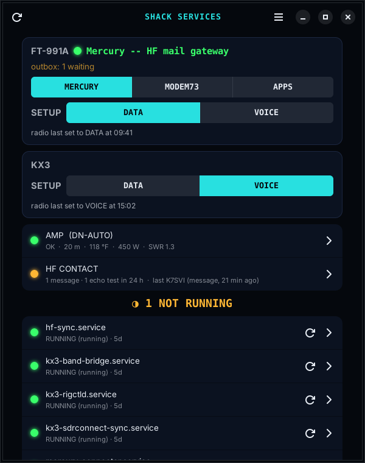
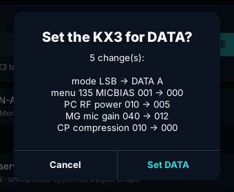
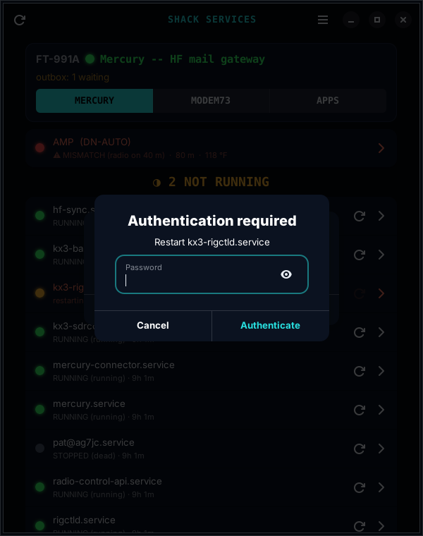
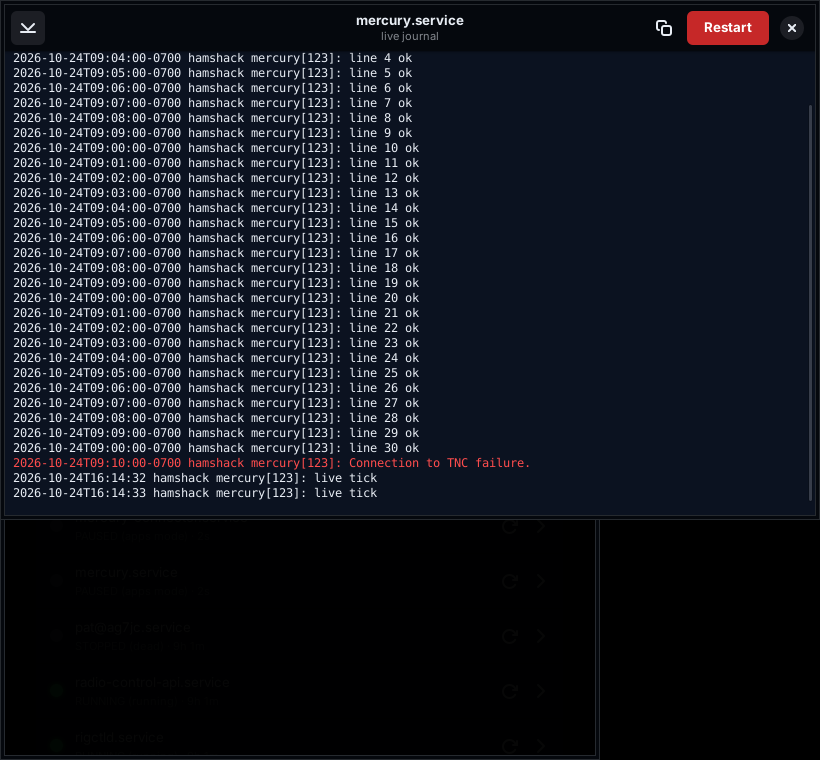

# Shack Services

A red/amber/green board for the systemd services a ham shack runs on, plus the switch for which program owns the data radio.



Built for a station where one radio (here an FT-991A) is shared by Mercury, a Reticulum HF modem (modem73) and WSJT-X/JS8Call, and only one of them can have it at a time.

## What it does

- **Services**: a light for each unit (running, starting, failed, stopped), how long it's been up, one-tap **restart**, and a **live log** that follows the journal. You get a desktop notification when one fails or stops, and again when it's back. The list is yours to edit.
- **Who has the radio**: MERCURY | MODEM73 | APPS. Switching stops the others, makes sure the radio isn't transmitting, and warns you if HF mail is waiting in the outbox, since it goes out as soon as Mercury starts. This is the `shack-mode` script, which works on its own in a terminal too.
- **DATA / VOICE setups** for the FT-991A and KX3, through [radio-profile](https://github.com/Saltyhaus/radio-profile). It shows what will change before writing anything.
- **AMP row**: band, temperature, power and SWR from [DN-AUTO Monitor](https://github.com/Saltyhaus/dnauto-linux-monitor), when it's running.
- **HF CONTACT row**: who's called your [HF Contact](https://github.com/Saltyhaus/hf-contact) station in the last 24 hours. Amber means a message came in; green with "on the air with…" means someone's linked right now. Tap it to open your inbox.
- **One password dialog** for everything that needs sudo, asked every time and never stored.
- Closing the window keeps it watching in the background; menu › **Quit** stops it.

| Before a setup change | Password | Live log |
|---|---|---|
|  |  |  |

## What you need

- Linux with systemd, GNOME (Wayland or X11), Python 3 with GTK 4 and libadwaita 1.4 or newer. With older ones it opens a plain Tk window instead.
- For the radio switch: the `shack-mode` script in this repo, `rigctld` for the radio, and Hamlib's `rigctl`.
- Optional: [radio-profile](https://github.com/Saltyhaus/radio-profile) for the DATA/VOICE rows, [DN-AUTO Monitor](https://github.com/Saltyhaus/dnauto-linux-monitor) for the AMP row.

## Install

```
git clone https://github.com/Saltyhaus/shack-services.git
cd shack-services
./install-gtk.sh "$PWD"
```

That installs the GTK packages, runs the tests, and adds **Shack Services** to the app grid, running from this folder, so `git pull` updates it. (Without an argument it copies itself to `~/shack-service-monitor` instead.)

The radio switch:

```
sudo install -m 755 shack-mode /usr/local/bin/shack-mode
shack-mode            # who has the radio right now
```

Open `shack-mode` and check the settings at the top before you use it. They're for my station, and you'll likely need to change them:

| Setting | Default |
|---|---|
| `RIG` | rigctld at `127.0.0.1:4532` |
| `CARD_NAME` | the radio's sound card, `CODEC` (the FT-991A's) |
| `SPOOL` | the outbox, `~/hf_spool/outgoing` |
| unit names | `mercury`, `mercury-connector` (system units), `modem73` (a user unit) |

## Your services

The first start writes `~/.config/shack-services/services.txt`, one unit per line, `#` for comments. Change it from menu › **Edit service list…**, for example:

```
rigctld.service
mercury.service
mercury-connector.service
# pat@youruser.service
```

## HF Contact alerts

`hf_alerts.py` watches mercury-connector's events file (`-e`) and tells you when a guest calls:

| | Desktop | Sound | Phone (ntfy) |
|---|---|---|---|
| Message | ✓ | their callsign in CW | ✓ |
| Echo test | ✓ | a short chirp | (off by default) |

```
cp hf-alerts.env.example ~/.config/hf-alerts/hf-alerts.env     # mkdir -p ~/.config/hf-alerts first
./hf_alerts.py --sinks                 # which sound output it will use
./hf_alerts.py --test message K1ABC    # try every channel once
```

Run it for good as a user service (edit the path in `ExecStart` if this folder isn't `~/github/shack-services`):

```
mkdir -p ~/.config/systemd/user && cp hf-alerts.service ~/.config/systemd/user/
systemctl --user daemon-reload && systemctl --user enable --now hf-alerts
```

- **Phone:** install the ntfy app (it works without Google services) and subscribe to the topic in `NTFY_URL`. On ntfy.sh, anyone who knows a topic name can read it, so make it long and random, or run your own server.
- **The sound never goes to a radio.** A radio's USB sound card is its transmit audio, and a chirp there could key it through VOX. Outputs matching `RADIO_SINKS` are refused. `--sinks` shows which.
- **Quiet hours** (default 22–7): no sound; the notification and push still go.
- To make the HF CONTACT row open your HF dashboard instead of the incoming folder, put its address in `~/.config/shack-services/hf-inbox.url`.

## Good to know

- `shack-mode` runs as you and asks for sudo itself. Run it without `sudo`.
- While Mercury is stopped on purpose, `/run/shack-mode` says so (mode, since when, which units), and Shack Services shows those units as PAUSED instead of red. An outside monitor can read the same file to tell "paused" from "down". `/run` is cleared at boot, so a reboot means Mercury again.
- Old window: `SSM_UI=tk ./service_monitor_launcher.sh`
- Tests: `python3 -m unittest test_notifier test_shack_mode test_setup_row test_hf_row test_hf_alerts`

## License

GPL-3.0-or-later. 73 de AG7JC.
